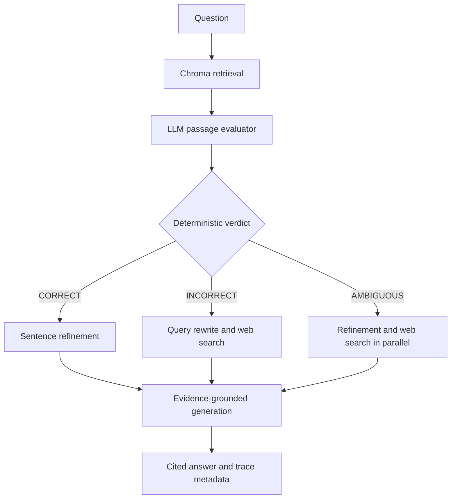

# Corrective RAG

**A retrieval-augmented generation service that evaluates its own evidence before answering.**

Corrective RAG adds a retrieval-quality decision step to conventional RAG. Rather than trusting nearest vector matches, the pipeline grades each passage and chooses whether to refine local evidence, search the web, or combine both sources.

## System workflow


| Verdict | Interpretation | Action |
|---|---|---|
| CORRECT | At least one passage fully answers | Refine and answer from local evidence |
| INCORRECT | No retrieved passage helps | Rewrite and search the web |
| AMBIGUOUS | Evidence is partial | Refine and search concurrently |

Every factual sentence should retain exact [KB:<id>] or [WEB:<url>] source tags. If no usable evidence survives, the service returns an explicit no-answer response.

## Engineering capabilities
- Passage-level relevance grading with strict structured output.
- Sentence-level evidence refinement and preserved source identifiers.
- Adaptive web fallback with bounded rate-limit retries.
- LangGraph state orchestration and parallel ambiguous branch.
- Chroma cosine retrieval over a validated JSON knowledge source.
- Retrieval evaluation with Recall@k, MRR and nDCG against a versioned golden set.
- FastAPI inference API, request IDs, request timing logs and health probes.
- Optional bearer-token protection and explicit CORS allow-list.
- Docker image, hardened local Compose setup and GitHub Actions CI.
- Unit and API tests with provider calls stubbed.

## Architecture and operations
- [Architecture and trust boundaries](docs/architecture.md)
- [Operations and deployment](docs/operations.md)

## Quick start
Requires Python 3.12+, uv and a [Groq API key](https://console.groq.com/keys).
```bash
git clone https://github.com/ABHILASH9519/Corrective-Rag.git
cd Corrective-Rag
cp .env.example .env
# Add GROQ_API_KEY to .env
uv sync --extra dev
uv run pytest -q
uv run crag evaluate --k 5
uv run crag ask -v "Ask a question supported by your knowledge base"
uv run crag serve
```
API docs: http://localhost:8000/docs

## API
POST /ask
```bash
curl -X POST http://localhost:8000/ask \
  -H "Content-Type: application/json" \
  -d '{"question":"What does the knowledge base say about the selected policy?"}'
```
When CRAG_API_TOKEN is configured, include Authorization: Bearer $CRAG_API_TOKEN.
The response includes answer, CRAG verdict, cited sources, passage similarities and evaluator labels, plus the rewritten web query when used.

Operational endpoints: GET /health/live, GET /health/ready and backwards-compatible GET /health.

## Retrieval evaluation
A small regression dataset lives in `data/evaluation_set.json`. Run:
```bash
uv run crag evaluate --dataset data/evaluation_set.json --k 5
```
The command measures Recall@k, Mean Reciprocal Rank (MRR) and normalized Discounted Cumulative Gain (nDCG@k). It does not invoke the LLM or web provider. The bundled questions are regression fixtures for the bundled illustrative corpus, not a statistically representative benchmark. Expand and review the dataset before making quality claims.

## Knowledge source
Edit data/knowledge_base.json or set CRAG_KB_PATH to a JSON array:
```json
[{"id":"policy-17","text":"The policy statement that can be retrieved and cited."}]
```
IDs are part of the citation contract. Keep them stable and unique. Set CRAG_CHROMA_DIR to persist the vector index.

Bundled knowledge records are illustrative, not authoritative policy or operational guidance. Replace them with reviewed, licensed and versioned source material before real decision use.

## Configuration
| Variable | Purpose |
|---|---|
| GROQ_API_KEY | Required provider credential |
| CRAG_API_TOKEN | Optional bearer token for inference |
| CRAG_ALLOWED_ORIGINS | Comma-separated trusted browser origins |
| CRAG_MODEL | LLM model identifier |
| CRAG_TOP_K | Number of passages evaluated |
| CRAG_WEB_RESULTS | Maximum web snippets fetched |
| CRAG_KB_PATH | Knowledge-base JSON path |
| CRAG_CHROMA_DIR | Persistent Chroma index directory |
| CRAG_LOG_LEVEL | Application log level |

## Quality checks
```bash
uv run ruff check .
uv run pytest -q
```
Tests stub model and web calls and do not require provider credentials.

## Current limitations and roadmap
This is a single-process API with a file-backed knowledge source and in-process Chroma index. It does not yet claim multi-tenant isolation, durable query history, distributed rate limiting, a managed vector database, a web console or production SLOs.

1. Versioned ingestion, chunking and re-indexing with source provenance.
2. Broader evaluation datasets and answer faithfulness/groundedness evaluation.
3. Persistent traces, cost/latency telemetry and operational dashboards.
4. Async execution, quotas and tenant-aware authorization.
5. Frontend workbench for retrieval, grades, evidence and citations.
6. Deployment automation, infrastructure-as-code and load/security testing.

## Technology
Python 3.12 · LangGraph · Chroma · Groq · FastAPI · Pydantic · Docker · GitHub Actions · pytest · Ruff

## Research foundation
Based on Corrective Retrieval Augmented Generation (Yan et al., 2024). The accompanying implementation guide's retrieve-grade-refine-search-generate workflow is the foundation; production controls and limitations are documented separately.

## License
MIT
