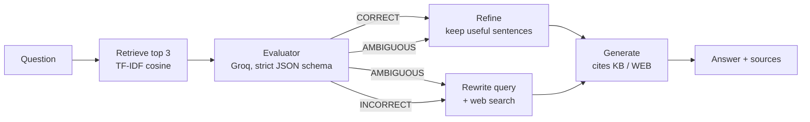

# Corrective RAG Help Desk

**A help desk that grades its own retrieval before it answers.** Written in Go with zero third-party dependencies: one static binary that serves a web UI, an HTTP API and a CLI.

> **Live demo:** _add your deployed URL here after deploying (see [Deploy](#deploy))_

Plain RAG trusts the top-k passages even when they only *look* related. Ask an Indian Railways bot about IndiGo baggage and it serves train-luggage notes. Corrective RAG (CRAG) catches that: an evaluator grades every retrieved passage, and the grade decides whether to answer from the notes, search the web, or do both.



| Verdict | Meaning | Action |
|---|---|---|
| `CORRECT` | at least one passage answers the question | keep only the sentences that matter |
| `INCORRECT` | nothing retrieved helps | rewrite the query, search the web |
| `AMBIGUOUS` | some passages help partly | do both **concurrently** and merge |

Every fact carries a source tag, `[KB:<id>]` or `[WEB:<url>]`. If neither source has the answer, it says it doesn't know instead of bluffing.

## What is original here

This project started from the *"Build a CRAG Help Desk in 50 Minutes"* tutorial by [@datasciencebrain](https://www.instagram.com/datasciencebrain/), a Python build (LangGraph, Chroma, Groq). The CRAG flow, the Indian Railways sample notes and the prompts follow that tutorial. Everything below is my own work on top of it:

- **Ported to Go**, stdlib only, replacing LangGraph and Chroma. Concurrency for the ambiguous branch uses goroutines.
- **Own retriever:** TF-IDF with cosine similarity, built from scratch, no vector database or model download.
- **Production concerns:** Groq client with `Retry-After`-aware backoff, per-IP rate limiting, concurrency cap, request timeouts, graceful shutdown, strict input validation, security headers, no provider details leaked in errors.
- **Evaluation harness** (`crag eval`) with a labelled question set, so quality is measured, not asserted.
- **Web UI** that shows how each answer was decided: per-passage grades, similarity, verdict, citations.
- **Interfaces for testing:** LLM and web search are swappable, giving 50+ offline tests under the race detector.

## Measured results

Retrieval check on 18 answerable questions (`crag eval -offline`, free, no API key):

| Metric | Result |
|---|---|
| Correct note ranked first | 16 / 18 (89%) |
| Correct note in top 3 | 18 / 18 (100%) |

CI fails if these drop below 70% and 90%. The live routing check (`crag eval`, needs a Groq key) tests whether the evaluator sends in-KB questions to the notes and out-of-KB questions to the web, using 18 in-KB and 6 out-of-KB questions. Run it yourself and put your numbers here.

## Quick start

Requires Go 1.24+ and a free [Groq API key](https://console.groq.com/keys).

```bash
git clone https://github.com/ABHILASH9519/Corrective-Rag
cd Corrective-Rag
cp .env.example .env            # put your GROQ_API_KEY in it
make build

./bin/crag serve                # web UI at http://localhost:8000
./bin/crag ask -v "What time does Tatkal booking open for AC classes?"
./bin/crag ask -v "How much check-in baggage can I carry on an IndiGo domestic flight?"
./bin/crag eval -offline        # retrieval quality, no key needed
./bin/crag eval                 # full routing evaluation (uses your Groq quota)
```

`-v` prints each passage's similarity and grade, the verdict and the web query.

### HTTP API

```bash
curl -s localhost:8000/ask -H 'content-type: application/json' \
  -d '{"question": "My train ran 5 hours late and I did not travel. How do I get a refund?"}'
```

Returns `answer`, `verdict`, `sources`, per-passage `passages` (similarity and label) and `web_query` when the web was used.

| Status | Meaning |
|---|---|
| 400 / 422 | malformed body / question too short or too long |
| 429 | per-client rate limit or server busy (`Retry-After` is set) |
| 502 / 504 | upstream failure / timeout |

`GET /health` reports version and model.

## Deploy

**Render (free tier):** New, Blueprint, select this repo. `render.yaml` is included. Set `GROQ_API_KEY` when asked. The service reads Render's `PORT`, trusts its proxy for client IPs and limits each visitor to 6 questions a minute, which protects your Groq quota on a public link. Free instances sleep when idle, so the first visit takes about 30 seconds.

**Docker anywhere:**

```bash
docker build -t corrective-rag .
docker run --rm -p 8000:8000 --env-file .env corrective-rag
```

The image is distroless and runs as non-root.

## Use your own knowledge base

Point `CRAG_KB_PATH` at a JSON file:

```json
[{"id": "refund-policy", "text": "Refunds are issued within 7 days. Shipping is not refunded."}]
```

IDs become citation tags. Set `CRAG_HELPDESK_NAME` and `CRAG_REWRITE_HINT` so web queries match your domain, and write your own `data/evaluation_set.json` to measure it. The bundled notes are simplified Indian Railways examples, **not an official IRCTC source**.

## Configuration

| Variable | Default | Purpose |
|---|---|---|
| `GROQ_API_KEY` | required | Groq API key |
| `CRAG_MODEL` | `openai/gpt-oss-120b` | grading and answering model |
| `CRAG_TOP_K` | `3` | passages sent to the evaluator |
| `CRAG_WEB_RESULTS` | `4` | web snippets per fallback |
| `CRAG_KB_PATH` | built-in | knowledge base file |
| `CRAG_ADDR` / `PORT` | `:8000` | listen address; `PORT` is used when set by a host |
| `CRAG_MAX_CONCURRENT` | `4` | simultaneous questions before `429` |
| `CRAG_RATE_PER_MINUTE` | `10` | per-client limit on `/ask`; `0` disables |
| `CRAG_TRUST_PROXY` | `false` | use the proxy-added client IP for limits |
| `CRAG_LOG_LEVEL` | `info` | `debug`, `info`, `warn`, `error` |
| `CRAG_HELPDESK_NAME` | `Indian Railways` | domain name used in prompts |
| `CRAG_REWRITE_HINT` | railway hint | extra rule for the query rewriter |
| `GROQ_BASE_URL` | Groq endpoint | any OpenAI-compatible API |

## Project layout

```
cmd/crag/             CLI: ask, serve, eval, version
data/                 knowledge_base.json, evaluation_set.json (embedded in the binary)
internal/config/      env and .env loading, validation
internal/kb/          JSON KB, TF-IDF index, cosine retrieval
internal/llm/         Groq client (strict JSON schema, retries) + Client interface
internal/evaluator/   grade passages, decide CORRECT / AMBIGUOUS / INCORRECT
internal/refine/      split into sentence strips, keep useful ones
internal/web/         query rewrite + DuckDuckGo search + Searcher interface
internal/pipeline/    the CRAG flow, concurrency, citations
internal/eval/        retrieval and routing evaluation
internal/server/      web UI, HTTP API, rate limiting, limits, logging
internal/llmtest/     fake LLM for tests
```

## Design decisions

- **Grading and deciding are separate.** `Grade` is the model's opinion; `Decide` is a plain rule (any relevant is `CORRECT`, all irrelevant is `INCORRECT`, else `AMBIGUOUS`) that is unit-tested without spending a token.
- **One batched grading call** for all passages, with a strict JSON schema so the output cannot drift.
- **A failing web search never fails the request.** The answer step then says it doesn't know.
- **Rightmost `X-Forwarded-For` entry** is used for rate limiting behind a proxy, because the leftmost is client-controlled and spoofable.

## Known limitations

- Retrieval is lexical (TF-IDF), so synonyms ("refund" vs "money back") can miss. The evaluator then routes to the web instead of answering wrongly. An embedding retriever behind the same interface is the obvious upgrade.
- DuckDuckGo's HTML endpoint is unofficial and can throttle or change markup. The parser is tested against a fixture; implement `web.Searcher` to use a paid search API.
- Web snippets are untrusted text. The answer prompt restricts the model to cited knowledge, but treat web-sourced answers accordingly.
- The 15 sample notes are a small, simplified corpus for demonstration.

## Development

```bash
make test     # go test -race ./...
make vet
make fmt
```

CI runs gofmt, vet, race tests, build, the offline retrieval check and a Docker build.

## Credits

- *Corrective Retrieval Augmented Generation*, Yan et al., 2024 (the method).
- *Build a CRAG Help Desk That Checks Its Own Retrieval in 50 Minutes*, [@datasciencebrain](https://www.instagram.com/datasciencebrain/) (the original Python tutorial this project started from).
- LLM inference by [Groq](https://groq.com).

## License

MIT
